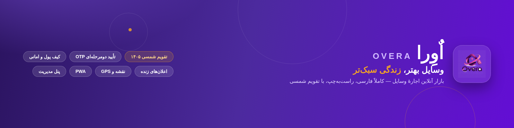
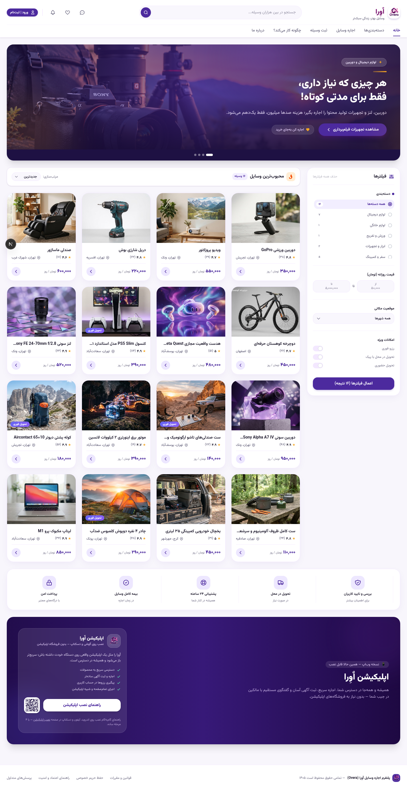
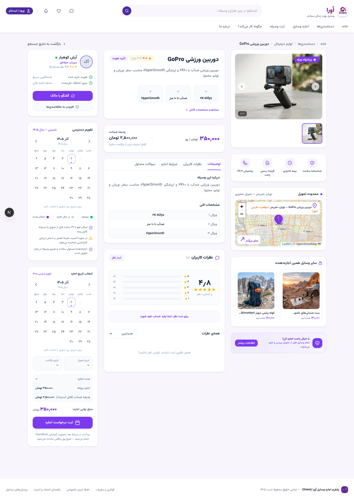
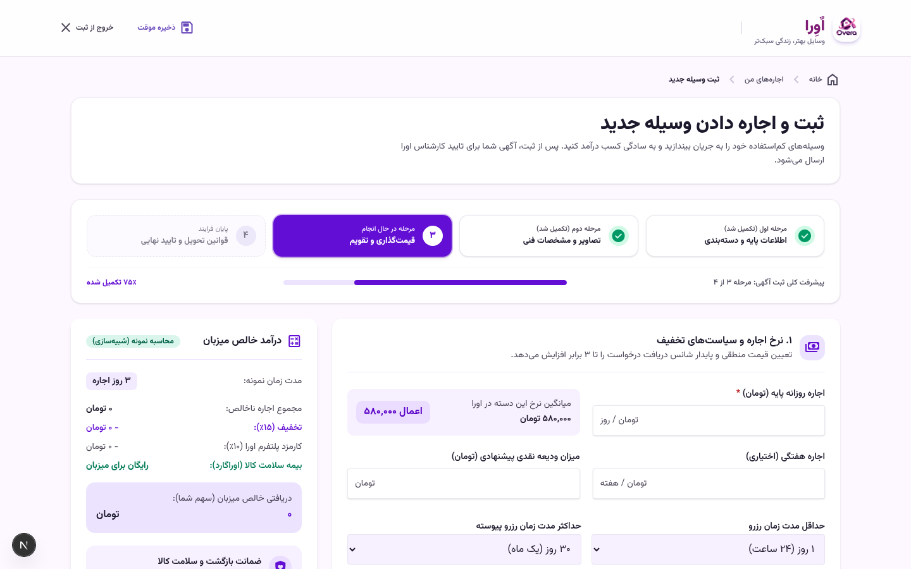
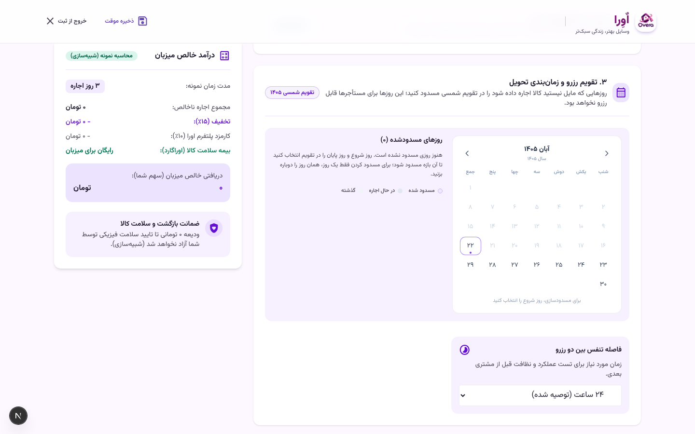
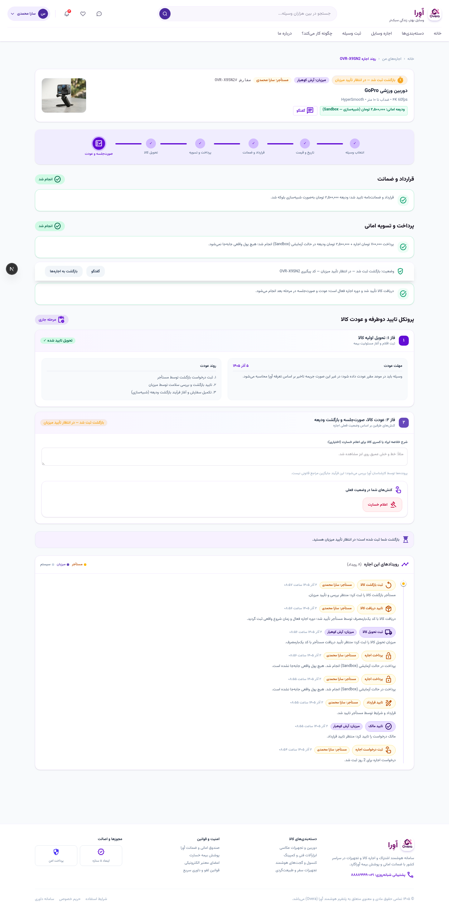
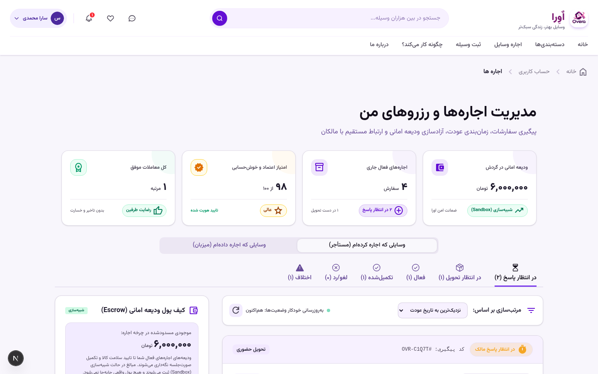

<div align="center">
  
  <h1>اُوِرا (Overa)</h1>
  <p><b>هر چیزی که نیاز داری، فقط برای مدتی کوتاه!</b><br>بازار آنلاین اجارهٔ وسایل به‌صورت پُست‌به‌پُست — کاملاً فارسی، راست‌به‌چپ و با تقویم شمسی</p>
  <p>
    
    
    
    
    
    
    
    
    
  </p>
</div>

---

## 🎯 اٌوِرا چیست؟

**اٌوِرا** یک بازار آنلاین اجارهٔ وسایل (Rental Marketplace) است که اجارهٔ «هر وسیله‌ای» را بین افراد ممکن می‌کند: از دوربین عکاسی و ابزار برقی گرفته تا کنسول بازی، چادر کمپینگ و صندلی ماساژور. **میزبان‌ها** وسیله‌های خود را با قیمت و تقویم دسترسی خودشان ثبت می‌کنند و **مستأجرها** دقیقاً روزهایی را که نیاز دارند رزرو می‌کنند — همه‌چیز با تقویم شمسی، اعتبارسنجی سرِور و چرخهٔ اجارهٔ شفاف.

این پروژه، پیاده‌سازی فول‌استک کاملِ پروتوتایپ ۲۹ صفحه‌ای اٌوِرا با **Next.js 16 (App Router)** است: هویت بصری، فونت وزیرمتن، پالت بنفش/طلایی و تمام تصاویر اصلی حفظ شده، اما پشت صحنه یک بک‌اند واقعی با **Prisma + SQLite**، احراز هویت، چرخهٔ حالت رزرو، کیف پول، چت، پنل مدیریت و CI/CD قرار گرفته است. تاریخچهٔ ریپو با **کامیت‌های تمیز و استاندارد (Conventional Commits)** نگهداری می‌شود.

---

## ✨ ویژگی‌های کلیدی

|                         |                                                                                                                                                                 |
| ----------------------- | --------------------------------------------------------------------------------------------------------------------------------------------------------------- |
| 🗓 **تقویم شمسی ۱۴۰۵**  | انتخاب بازهٔ تحویل و بازگشت با تقویم جلالی اختصاصی؛ روزهای گذشته و رزروشده غیرفعال‌اند، روزهای مسدودِ میزبان نمایش داده می‌شوند و پیام‌های خطا فارسی و دقیق‌اند |
| 🔁 **چرخهٔ کامل اجاره** | ماشین‌حالت رزرو با ۱۲ وضعیت (REQUESTED → APPROVED → … → COMPLETED)؛ همهٔ گذارها سمت سرور با سطح دسترسی نقش‌ها اعتبارسنجی می‌شوند و تست واحد دارند               |
| 🧙 **ویزارد ثبت وسیله** | ثبت آگهی در ۴ مرحله (اطلاعات پایه ← تصاویر ← قیمت‌گذاری و تقویم ← قوانین تحویل) با پیش‌نمایش زنده و ماشین‌حساب درآمد میزبان                                     |
| 🔐 **احراز هویت واقعی** | ورود با رمز (هش scrypt) + ورود با کد یک‌بارمصرف (OTP)؛ کوکی سشن امضاشده و کنترل نقش در همهٔ APIها                                                               |
| 🤝 **اعتماد و شفافیت**  | ودیعه و پرداخت با برچسب شفاف «شبیه‌سازی (Sandbox)»، امانی (Escrow) شبیه‌سازی‌شده، سنجش اعتماد کاربران، داوری اختلاف و ادعای خسارت                               |
| 💬 **تعامل زنده**       | چت بین مستأجر و میزبان، اعلان‌ها، نظرات و پاسخ میزبان، علاقه‌مندی‌ها و کیف پول با دفتر تراکنش                                                                   |
| 👮 **پنل مدیریت**       | تأیید آگهی‌ها، مدیریت کاربران، رسیدگی به ادعاها و لاگ ممیز (Audit Log)                                                                                          |
| 📱 **PWA**              | بدون استور، مثل اپ واقعی روی اندروید، iOS و دسکتاپ نصب می‌شود؛ آیکون اختصاصی و کش آفلاین                                                                        |
| 🧭 **RTL ریسپانسیو**    | چیدمان راست‌به‌چپ کامل در موبایل، تبلت و دسکتاپ با فونت وزیرمتن                                                                                                 |
| ⚙️ **CI/CD آماده**      | GitHub Actions برای lint، تایپ‌چک، تست، بیلد و اسموک‌تست + انتشار خودکار ایمیج داکر روی GHCR                                                                    |

---

## 📸 نگاهی به اٌوِرا

<table>
  <tr>
    <td width="50%" align="center"><br><sub><b>صفحهٔ اصلی</b> — هیرو، دسته‌بندی‌ها و فیلترها</sub></td>
    <td width="50%" align="center"><br><sub><b>صفحهٔ جزئیات وسیله</b> — گالری، قیمت، ودیعه و تقویم شمسی</sub></td>
  </tr>
  <tr>
    <td width="50%" align="center"><br><sub><b>مرحلهٔ ۳ ویزارد ثبت وسیله</b> — قیمت‌گذاری و ماشین‌حساب درآمد</sub></td>
    <td width="50%" align="center"><br><sub><b>تقویم شمسی ۱۴۰۵</b> — مسدودسازی روزها توسط میزبان</sub></td>
  </tr>
  <tr>
    <td width="50%" align="center"><br><sub><b>پنل میزبان</b> — درآمد، امتیاز اعتبار و آمار اجاره‌ها</sub></td>
    <td width="50%" align="center"><br><sub><b>مدیریت اجاره‌ها</b> — رزرو فعال، ودیعه امانی و گفتگو</sub></td>
  </tr>
</table>

---

## 🚀 اجرای پروژه از صفر تا صد

### گام ۰ — پیش‌نیازها

| ابزار                                              | نسخهٔ پیشنهادی | نصب                                                           |
| -------------------------------------------------- | -------------- | ------------------------------------------------------------- | --------------------------------------------------- | ----- |
| **Bun** (اجبار؛ ران‌تایم تست و seed)               | 1.2 به بالا    | ویندوز (PowerShell): `powershell -c "irm bun.sh/install.ps1   | iex"`— لینوکس/مک:`curl -fsSL https://bun.sh/install | bash` |
| **Git**                                            | آخرین نسخه     | [git-scm.com](https://git-scm.com)                            |
| **Docker Desktop** (اختیاری — برای اجرای کانتینری) | آخرین نسخه     | [docker.com](https://www.docker.com/products/docker-desktop/) |

> 💡 اگر فقط می‌خواهید سریع امتحان کنید، مسیر **داکر** در انتهای همین بخش با یک دستور بالا می‌آید.

### گام ۱ — دریافت کد

```bash
git clone https://github.com/USERNAME/REPO-NAME.git
cd Overa-fullsatck
```

### گام ۲ — نصب وابستگی‌ها

```bash
bun install
```

### گام ۳ — تنظیم متغیرهای محیطی

از فایل نمونه یک `.env` بسازید:

```bash
# لینوکس / مک
cp .env.example .env

# ویندوز (PowerShell)
copy .env.example .env
```

برای اجرای **محلی** (بدون داکر) مقدار `DATABASE_URL` را به مسیری داخل پروژه تغییر دهید و پوشهٔ آن را بسازید:

```env
DATABASE_URL=file:../db/custom.db
```

```bash
# لینوکس / مک
mkdir -p db

# ویندوز (PowerShell)
md db
```

> ⚙️ مسیرهای SQLite نسبت به فایل `prisma/schema.prisma` حل می‌شوند؛ بنابراین `file:../db/custom.db` یعنی پوشهٔ `db` در ریشهٔ پروژه. در حالت داکر نیازی به تغییر این مقدار نیست — فایل `docker-compose.yml` خودش `DATABASE_URL=file:/app/db/custom.db` را ست می‌کند.

### گام ۴ — ساخت اسکیمای دیتابیس

```bash
bun run db:push
```

> در صورتی که از نسخهٔ قبلی ارتقا می‌دهید، مایگریشن جدید
> `20261122000000_signature_and_geo` (مختصات نقشهٔ وسایل + امضای دیجیتال
> قرارداد) به‌صورت افزایشی اعمال می‌شود — هیچ داده‌ای تغییر نمی‌کند.

### گام ۵ — دادهٔ نمونه (Seed)

```bash
bun run seed
```

این دستور یک کاتالوگ دموی کامل می‌سازد: **۸ کاربر، ۱۸ وسیله، ۸ دسته‌بندی و ۶ رزرو واقعی** — تا اولین لحظهٔ ورود، سایت زنده و پر باشد.

برای وسایل موجود بدون مختصات نقشه (داده‌های قدیمی)، یک بار اجرا کنید:

```bash
bun run db:coords
```

این اسکریپت برای هر وسیلهٔ بدون `lat/lng` یک موقعیت پایدار نزدیک مرکز شهر همان وسیله ثبت می‌کند تا نقشه‌ها پین واقعی داشته باشند.

### گام ۶ — اجرا 🎉

```bash
bun run dev
```

حالا [http://localhost:3000](http://localhost:3000) را باز کنید.

### حساب‌های دمو

رمز عبور همهٔ حساب‌ها: `overa1234`

| نقش       | شماره موبایل  | چه چیزهایی می‌بینید                           |
| --------- | ------------- | --------------------------------------------- |
| 🧑 مستأجر | `09121111111` | اجاره‌ها، چت، کیف پول، ادعای خسارت            |
| 🏠 میزبان | `09122222222` | پنل میزبان، وسایل من، نظرات، ویزارد ثبت وسیله |
| 👮 مدیر   | `09120000000` | پنل ادمین، پنل داوری                          |

> 🔑 ورود با OTP تا زمانی که سرویس پیامک تنظیم نشود در **حالت دمو** کار می‌کند: کد روی صفحه با برچسب «حالت توسعه» نمایش داده می‌شود.

### مسیر جایگزین — اجرا با داکر 🐳

```bash
docker compose up -d --build   # بیلد + اجرا (http://localhost:3000)
docker compose logs -f app     # دنبال کردن لاگ‌ها
docker compose down            # توقف (داده‌ها در والیوم overa_db می‌مانند)
```

- در اولین اجرا، اسکیمای Prisma اعمال و دادهٔ نمونه به‌صورت خودکار seed می‌شود (با تلاش مجدد برای خطاهای گذرا).
- داده‌ها در والیوم `overa_db` باقی می‌مانند و با حذف کانتینر پاک نمی‌شوند.
- اگر seed در محیط پرترافیک بار اول کامل نشد، فقط یک‌بار `docker compose restart app` بزنید.

### بیلد پروداکشن

```bash
bun run build    # خروجی standalone در .next/standalone
bun run start    # سرو کردن بیلد پروداکشن
```

---

## 🧪 تست و کیفیت

```bash
bun test              # تست‌های واحد (ماشین‌حالت رزرو، توابع تقویم جلالی و فرمت‌ها)
bun run lint          # ESLint
bunx tsc --noEmit     # تایپ‌چک کامل TypeScript
```

| Workflow             | زمان اجرا                   | کار                                                                                |
| -------------------- | --------------------------- | ---------------------------------------------------------------------------------- |
| `ci.yml`             | هر push / PR                | نصب (با lockfile) → Prisma validate → lint → تایپ‌چک → تست → بیلد → اسموک‌تست سرور |
| `docker-publish.yml` | push روی main و تگ‌های `v*` | بیلد ایمیج چندمرحله‌ای و انتشار روی GHCR                                           |
| `vercel.yml`         | دستی (workflow_dispatch)    | دیپلوی Vercel با توکن اختصاصی                                                      |

---

## 🛠 استک فنی

| لایه       | تکنولوژی                                                          |
| ---------- | ----------------------------------------------------------------- |
| فریم‌ورک   | Next.js 16 (App Router) + React 19 + TypeScript 5                 |
| استایل     | Tailwind CSS 4 با توکن‌های طراحی اٌوِرا + کامپوننت‌های shadcn/ui  |
| دیتابیس    | SQLite با Prisma ORM 6                                            |
| احراز هویت | کوکی سشن + هش scrypt + OTP (حالت دمو تا اتصال سرویس پیامک)        |
| ران‌تایم   | Bun (dev، تست، seed)                                              |
| جعبه‌ابزار | Radix UI، Recharts، react-hook-form + zod، framer-motion          |
| استقرار    | Docker چندمرحله‌ای + docker-compose + GitHub Actions              |
| سایر       | PWA (Service Worker + Manifest)، چت polling سبک، خروجی standalone |

---

## 📚 مستندات بیشتر

| فایل                                 | موضوع                                       |
| ------------------------------------ | ------------------------------------------- |
| `docs/ARCHITECTURE.md`               | معماری کلی و لایه‌های پروژه                 |
| `docs/ROUTES-AND-PAGES.md`           | فهرست کامل مسیرها و صفحات                   |
| `docs/DEPLOYMENT.md`                 | استقرار، متغیرهای محیطی و نکات seed در داکر |
| `docs/JALALI-CALENDAR-AND-FILTER.md` | معماری تقویم شمسی و فیلترهای صفحهٔ اصلی     |
| `docs/PWA.md`                        | جزئیات فنی Progressive Web App              |
| `docs/PROJECT-STATE.md`              | وضعیت دقیق پیاده‌سازی                       |
| `docs/CHANGELOG.md`                  | تاریخچهٔ تغییرات                            |

---

## ⚠️ محدودیت‌های شناخته‌شده

- پرداخت، ودیعه و امانی **شبیه‌سازی‌شده (Sandbox)** هستند و عمداً هیچ جریان پول واقعی ادعا نمی‌شوند.
- OTP تا زمانی که کلید سرویس پیامک تنظیم نشود، فقط در حالت دمو با کد نمایان کار می‌کند.
- تصاویر وسیله از گوشی/لپ‌تاپ آپلود می‌شوند (فشرده‌سازی سمت مرورگر + `/api/uploads`، ذخیره در `public/uploads`)؛ انتقال به Object Storage ابری برای محیط واقعی توصیه می‌شود.
- نقشه‌ها Leaflet + کاشی‌های OpenStreetMap از CDN هستند و جستجوی آدرس از Nominatim؛ در محیط بدون اینترنت، نقشه‌ها به کارت مختصات با لینک خارجی برمی‌گردند.
- گفتگوی پروندهٔ خسارت **فقط متنی** است (تصویر/ویس/فایل در سمت سرور هم رد می‌شود) و چت عمومی به‌جای WebSocket از polling سبک ۴ ثانیه‌ای استفاده می‌کند (سازگار با Vercel).
- امضای دیجیتال قرارداد فقط توسط **مستأجر** با کد یک‌بارمصرف ثبت می‌شود (میزبان امضا نمی‌کند)؛ کیف پول هرگز مقدار منفی نمی‌گیرد و پرداخت بدون موجودی کافی به «شارژ کیف پول» راهنمایی می‌شود.

---

<div align="center">

**اُوِرا** — وسایل بهتر، زندگی سبک‌تر 🌿

اگر این پروژه برایتان مفید بود، یک ⭐ به ریپو بدهید!

</div>
